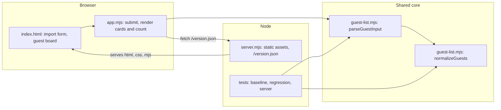
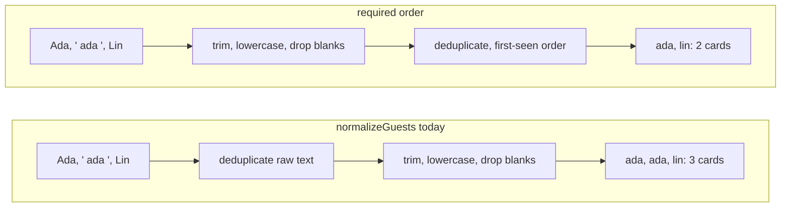

# Guestboard duplicate repair

## Problem

Importing the same guest with different casing or surrounding spaces creates duplicate
guest cards and inflates the guest count. `Ada`, ` ada `, and `Lin` must produce two
cards and a count of two. Blank lines stay ignored, and distinct guests keep their
first-seen order.

## Codebase architecture



- `index.html` and `app.mjs` are the browser UI. `app.mjs` reads the textarea on
  submit, calls `parseGuestInput`, and renders one card per returned handle plus the
  count.
- `guest-list.mjs` is the shared core. `parseGuestInput` splits lines and enforces the
  size limits; `normalizeGuests` trims, lowercases, drops blanks, and deduplicates.
  The same module runs in the browser and in the Node tests.
- `server.mjs` serves an explicit list of static assets and `/version.json` (branch,
  commit, dirty state), which the footer displays.

## Where the issue is



`normalizeGuests` deduplicates before it normalizes, so `Ada` and ` ada ` are still
different strings when the duplicate check runs. Normalizing first fixes it in the
shared core. The parser, browser code, and server do not change.

## Delivery plan

1. `guest-board` — fix the visible contract: two cards and a count of two.
2. `guest-normalizer` — normalize handles before deduplication in `normalizeGuests`.
3. `input-parser` — run `tests/regression.test.mjs`, which covers `normalizeGuests`
   and the full `parseGuestInput` import path.
4. `source-version` — review the exact committed revision against the contract.
5. `guest-board` — summarize the result and any remaining limitation.

Work items start with their component id, so selecting a component in the map shows
the work for that part of the app. Blue marks the component being worked on now;
green marks a finished one.

```arch
{
  "v": 1,
  "kind": "layered",
  "title": "Guestboard web app architecture",
  "layers": [
    {
      "id": "browser-ui",
      "title": "Browser UI",
      "detail": "index.html + app.mjs",
      "items": [
        { "id": "import-form", "label": "Import form", "detail": "Textarea and import action" },
        { "id": "guest-board", "label": "Guest board", "detail": "Cards, count, and status" }
      ]
    },
    {
      "id": "guest-core",
      "title": "Guest-list core",
      "detail": "guest-list.mjs, shared by browser and tests",
      "items": [
        { "id": "input-parser", "label": "Input parser", "detail": "parseGuestInput: lines and limits" },
        { "id": "guest-normalizer", "label": "Guest normalizer", "detail": "normalizeGuests: trim, case, dedupe" }
      ]
    },
    {
      "id": "preview-delivery",
      "title": "Preview delivery",
      "detail": "server.mjs",
      "items": [
        { "id": "preview-server", "label": "Preview server", "detail": "Explicit static assets only" },
        { "id": "source-version", "label": "Source revision", "detail": "/version.json: branch and commit" }
      ]
    }
  ],
  "flows": [
    { "from": "browser-ui", "to": "guest-core", "label": "raw lines / normalized guests" },
    { "from": "preview-delivery", "to": "guest-core", "label": "ES module + revision" }
  ]
}
```

## Verification

- `node --test tests/regression.test.mjs` must pass 2 of 2 on the committed revision:
  case and whitespace variants collapse to one guest, and the audience import yields
  `ada`, `lin` in first-seen order.
- Results name the exact commit they ran against. A component turns green only after
  its result exists.
